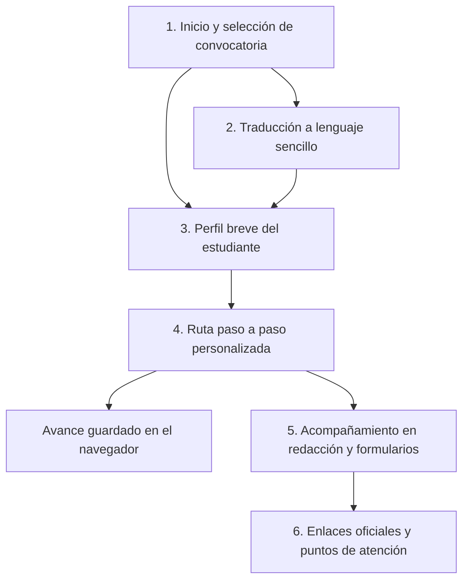
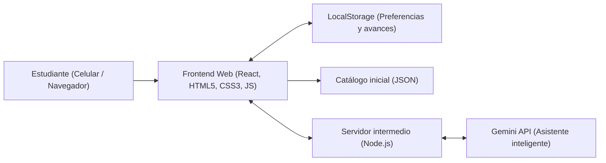

# BecaLink

**Aplicación web responsiva de acompañamiento inteligente para el acceso a becas y apoyos educativos**

| Dato | Detalle |
|---|---|
| Equipo | Bubulubu |
| Campus | San Rafael – Reforma |
| Reto | Reto 1: "Puentes de oportunidad – Reducción de la brecha de acceso" (ODS 10) |
| Integrantes | Carmona Orea Lizbeth<br>Gael Darío Squivias Moran<br>Leslie Berenice Plata Hernández |
| Repositorio | [github.com/Dsquip/Becalink](https://github.com/Dsquip/Becalink) |
| Demo en vivo | [PENDIENTE] |
| Licencia | [PENDIENTE] |

## Tabla de contenido

1. [Resumen ejecutivo](#1-resumen-ejecutivo)
2. [Boceto y concepto](#2-boceto-y-concepto)
3. [Documentación funcional](#3-documentación-funcional)
4. [Documentación técnica](#4-documentación-técnica)
5. [Manual de usuario](#5-manual-de-usuario)
6. [Accesibilidad e impacto](#6-accesibilidad-e-impacto)
7. [Declaración de uso de IA](#7-declaración-de-uso-de-ia)

---

## 1. Resumen ejecutivo

BecaLink es una aplicación web responsiva para celulares que democratiza el acceso a becas, apoyos económicos y procesos de admisión educativa. Está diseñada para estudiantes de primera generación con recursos económicos o conectividad limitados que carecen de acompañamiento familiar o institucional. Su innovación consiste en integrar Gemini como asistente inteligente para eliminar la barrera del lenguaje burocrático: traduce convocatorias complejas a explicaciones claras, genera rutas paso a paso personalizadas según el perfil del estudiante y acompaña la redacción de cartas y formularios, ayudando a que más jóvenes completen sus postulaciones en condiciones equitativas.

---

## 2. Boceto y concepto

### El problema

Las convocatorias de becas, apoyos económicos y procesos de admisión educativa suelen publicarse en lenguaje burocrático, técnico o poco claro. Esta barrera informativa provoca que miles de jóvenes con talento desistan o queden fuera de oportunidades clave por no comprender los requisitos, los plazos o el procedimiento correcto para postularse. El problema afecta con mayor fuerza a estudiantes de primera generación que no cuentan con acompañamiento familiar o institucional cercano para interpretar estos trámites.

### Propuesta de solución

BecaLink es una aplicación web responsiva diseñada prioritariamente para celulares que actúa como un puente informativo y guía práctica. Mediante inteligencia artificial (Gemini), transforma textos oficiales extensos en explicaciones comprensibles, construye una ruta de acción personalizada según el perfil del estudiante y brinda acompañamiento en la preparación de documentos clave, canalizando siempre a los enlaces oficiales o puntos de atención correspondientes.

### Flujo general de pantallas



**Descripción de pantallas:**

1. **Inicio y selección de convocatoria:** pantalla principal adaptada a dispositivos móviles. Permite explorar el catálogo inicial de convocatorias (almacenado en formato JSON) o ingresar una convocatoria o consulta específica.
2. **Traducción a lenguaje sencillo:** presenta la convocatoria seleccionada convertida en una explicación clara, empática y adaptada al nivel de lectura del estudiante, resaltando los puntos esenciales sin jerga administrativa.
3. **Perfil breve del estudiante:** formulario corto donde el usuario comparte datos básicos necesarios para contextualizar su postulación ([PENDIENTE: especificar campos exactos del perfil]).
4. **Ruta paso a paso personalizada:** lista de verificación ordenada con los documentos por reunir, las fechas límite y las acciones inmediatas. El estudiante puede marcar sus avances, los cuales se conservan en su navegador mediante LocalStorage.
5. **Acompañamiento en redacción y formularios:** espacio asistido que guía al usuario para estructurar cartas de motivos o responder formularios socioeconómicos sin tecnicismos.
6. **Enlaces oficiales y puntos de atención:** sección de cierre que dirige al estudiante a los portales oficiales o instancias correspondientes para completar su trámite de forma segura.

**Bocetos visuales / wireframes:** [PENDIENTE: insertar capturas o enlace a prototipo]

### Alineación con los ODS

- **ODS 10 — Reducción de las desigualdades:** democratiza el acceso a información sobre financiamiento y movilidad educativa. Al eliminar la barrera del lenguaje técnico y la desinformación, permite que jóvenes en desventaja compitan en condiciones más equitativas por becas y apoyos escolares.
- **ODS 11 — Ciudades y comunidades sostenibles:** fortalece la inclusión social y la equidad en comunidades urbanas y periurbanas al conectar a jóvenes de zonas vulnerables con servicios educativos y recursos comunitarios locales, impulsando comunidades más inclusivas y con mayor movilidad social.

---

## 3. Documentación funcional

Las capacidades principales de BecaLink se estructuran en tres funciones impulsadas por Gemini.

### Función 1: Traducción de lenguaje burocrático a lenguaje sencillo

- **Descripción:** procesa convocatorias oficiales extensas y las convierte en explicaciones claras, empáticas y adaptadas al nivel de lectura del estudiante.
- **Qué entra:** texto de una convocatoria oficial o convocatoria seleccionada del catálogo inicial en JSON, junto con la consulta del estudiante.
- **Qué sale:** resumen y explicación estructurada en lenguaje sencillo, libre de tecnicismos innecesarios, con los puntos clave de la oportunidad.
- **Rol de Gemini:** lee el contenido oficial, interpreta la terminología administrativa y redacta una versión accesible y comprensible para el estudiante.

### Función 2: Generación de rutas paso a paso personalizadas

- **Descripción:** crea un plan de acción ordenado para que el estudiante sepa exactamente qué reunir y qué hacer antes del cierre de la convocatoria.
- **Qué entra:** perfil breve del estudiante y datos de la convocatoria elegida.
- **Qué sale:** lista de verificación paso a paso con documentos requeridos, fechas límite y acciones inmediatas, guardada localmente en el navegador (LocalStorage) para dar seguimiento al avance.
- **Rol de Gemini:** analiza el perfil del usuario frente a los requisitos de la convocatoria y genera la secuencia personalizada de pasos, prioridades y entregables.

### Función 3: Acompañamiento en redacción y preparación

- **Descripción:** orienta al estudiante en la preparación de documentos clave de su postulación y lo dirige a los canales formales de entrega.
- **Qué entra:** dudas del estudiante, información base para su carta de motivos o campos de formularios socioeconómicos que no comprende.
- **Qué sale:** guía estructurada para redactar la carta o llenar el formulario sin tecnicismos, además de la canalización hacia los enlaces oficiales o puntos de atención correctos.
- **Rol de Gemini:** actúa como guía conversacional para ayudar a estructurar ideas, aclarar preguntas frecuentes de los formularios y orientar al usuario hacia los canales oficiales indicados.

---

## 4. Documentación técnica

### Arquitectura general

BecaLink implementa una arquitectura cliente-servidor ligera. El navegador del usuario ejecuta la interfaz en React y almacena el progreso localmente; todas las solicitudes de inteligencia artificial pasan por un servidor intermedio en Node.js que resguarda la clave de acceso a la Gemini API.



### Stack tecnológico

| Tecnología | Propósito en el proyecto |
|---|---|
| HTML5 | Estructura semántica de las pantallas de la aplicación web. |
| CSS3 | Diseño visual y adaptación responsiva para pantallas de celulares. |
| JavaScript | Lógica de funcionalidad, eventos e interacción del usuario. |
| React | Desarrollo modular de los componentes de la interfaz de usuario. |
| Node.js (v26.13.1 LTS) | Servidor intermedio que recibe peticiones del frontend y se conecta de forma segura con la Gemini API sin exponer credenciales. |
| Gemini API | Motor de inteligencia artificial que impulsa el asistente de becas (traducción, rutas y acompañamiento). |
| JSON | Almacenamiento del catálogo inicial de convocatorias. |
| LocalStorage | Persistencia local en el navegador para guardar preferencias y avances del estudiante sin requerir infraestructura compleja de cuentas. |
| GitHub | Alojamiento del código fuente, control de versiones y documentación del proyecto. |
| Google AI Studio | Entorno utilizado para la generación y desarrollo asistido de la aplicación. |

### Integración de Gemini en el flujo de la aplicación

1. **Captura en el cliente:** desde la interfaz en React, el estudiante selecciona una convocatoria del catálogo JSON, envía una consulta, llena su perfil breve o solicita apoyo de redacción.
2. **Envío seguro al backend:** el frontend envía la solicitud al servidor intermedio en Node.js ([PENDIENTE: documentar rutas/endpoints exactos, p. ej. `POST /api/...`]).
3. **Procesamiento en Gemini API:** el servidor en Node.js añade la clave de la API almacenada en variables de entorno (nunca expuesta en el navegador), construye la petición con el contexto correspondiente a la función invocada (1, 2 o 3) y consulta a la Gemini API ([PENDIENTE: especificar versión exacta del modelo de Gemini utilizado]).
4. **Respuesta y persistencia local:** Node.js devuelve la respuesta procesada al frontend en React, que la presenta en formato claro y permite guardar los avances del estudiante en LocalStorage.

### Estructura sugerida de carpetas del repositorio

```text
becalink/
├── client/                     # Aplicación frontend (React, HTML5, CSS3, JS)
│   ├── public/                 # Archivos públicos estáticos
│   └── src/
│       ├── components/         # Componentes reutilizables de la interfaz
│       ├── data/
│       │   └── convocatorias.json  # Catálogo inicial de convocatorias
│       ├── services/           # Comunicación con el servidor Node.js y LocalStorage
│       └── App.jsx             # Punto de entrada principal de vistas
├── server/                     # Servidor intermedio (Node.js)
│   ├── routes/                 # Endpoints para las funciones de Gemini
│   ├── services/               # Cliente e integración con Gemini API
│   └── index.js                # Configuración y arranque del servidor
├── docs/                       # Material adicional y bocetos [PENDIENTE]
├── .env.example                # Plantilla de variables de entorno (sin claves reales)
├── .gitignore                  # Exclusión de node_modules y archivos .env
└── README.md                   # Documentación principal del proyecto
```

### Instrucciones para ejecutar el proyecto en local

**Prerrequisitos:**

- Node.js v26.13.1 (última versión LTS) instalado. Se puede descargar en [nodejs.org](https://nodejs.org/en/download).
- Gestor de paquetes npm ([PENDIENTE: indicar si se usa npm, pnpm o yarn]).
- Una clave válida de la Gemini API obtenida en Google AI Studio.

**Pasos de instalación y ejecución:**

1. Clonar el repositorio:

   ```bash
   git clone https://github.com/Dsquip/Becalink.git
   cd Becalink
   ```

2. Configurar variables de entorno del servidor. Crea un archivo `.env` en la carpeta del servidor (tomando como referencia `.env.example`) y agrega tu clave de la Gemini API:

   ```env
   [PENDIENTE: NOMBRE_VARIABLE_API_KEY]=tu_clave_de_gemini_aqui
   PORT=[PENDIENTE: PUERTO_SERVIDOR]
   ```

3. Instalar dependencias e iniciar el servidor (Node.js):

   ```bash
   cd server
   npm install
   [PENDIENTE: comando de arranque del servidor, p. ej. npm start]
   ```

4. Instalar dependencias e iniciar la interfaz web (React). En una nueva terminal:

   ```bash
   cd client
   npm install
   [PENDIENTE: comando de arranque del cliente, p. ej. npm run dev]
   ```

5. Abrir la aplicación: accede desde el navegador a [PENDIENTE: URL local, p. ej. `http://localhost:5173`].

### Limitaciones conocidas

- **Persistencia únicamente local:** al guardar preferencias y avances en LocalStorage, el progreso pertenece al navegador y dispositivo desde donde se usa la app. Si el usuario cambia de celular o borra los datos del navegador, su lista guardada no se transfiere automáticamente.
- **Catálogo inicial estático:** las convocatorias precargadas provienen de un archivo JSON inicial y requieren actualización manual para incorporar nuevas convocatorias o cambios en plazos.
- **Dependencia de conexión para funciones de IA:** aunque la interfaz está pensada para ser ligera en celular, las consultas procesadas por Gemini requieren conexión a internet activa.
- **Carácter orientativo de las respuestas:** la información simplificada y las guías generadas con IA son un apoyo; el estudiante debe confirmar siempre requisitos finales, fechas y envío directamente en los enlaces oficiales de cada institución.
- **Otras limitaciones técnicas específicas** (límites de caracteres o cuotas de API): [PENDIENTE].

---

## 5. Manual de usuario

¡Hola! Bienvenido a BecaLink. Esta herramienta está pensada para acompañarte paso a paso en la búsqueda y postulación a becas o apoyos educativos, sin palabras enredadas ni trámites confusos. Puedes usarla directamente desde tu celular.

### Paso 1: Entra a BecaLink desde tu celular

1. Abre el navegador de internet de tu celular (como Chrome o Safari).
2. Escribe o toca el enlace de la aplicación: [PENDIENTE: enlace oficial de BecaLink].
3. No necesitas descargar nada ni ocupar memoria de tu teléfono.

### Paso 2: Entiende cualquier convocatoria en palabras claras

Si encontraste una beca pero el texto oficial es muy largo o difícil de entender:

1. Elige una convocatoria de la lista inicial de BecaLink o escribe/pega tu duda o el texto de la convocatoria que quieres revisar.
2. Presiona el botón para simplificar la información ([PENDIENTE: nombre exacto del botón en la interfaz]).
3. En unos segundos verás una explicación clara: de qué trata la beca, quién puede participar y qué te piden, explicado de forma sencilla.

### Paso 3: Crea tu ruta paso a paso

Para no perderte entre tantos documentos y fechas:

1. Responde unas preguntas cortas sobre tu situación actual para armar tu perfil breve.
2. BecaLink te mostrará una lista ordenada con:
   - Los documentos que necesitas juntar.
   - La fecha límite para no quedarte fuera.
   - Qué te conviene hacer primero.
3. Conforme vayas juntando tus papeles, marca cada paso como completado. Tu avance se guarda automáticamente en el navegador de tu celular, así que puedes cerrar la página y volver después sin empezar de cero.

### Paso 4: Prepara tu carta de motivos o tus formularios

Muchas becas piden una carta de motivos o un formulario socioeconómico y no siempre es fácil saber cómo empezar:

1. Entra a la sección de apoyo para redacción y formularios.
2. Cuenta con tus propias palabras qué necesitas responder o qué quieres expresar en tu carta.
3. BecaLink te ayudará a ordenar tus ideas de forma clara y respetuosa, sin palabras complicadas.
4. Cuando tengas todo listo, usa los enlaces oficiales o puntos de atención que te muestra la app para enviar tu solicitud directamente en la página de la institución que entrega la beca.

### Consejos útiles para aprovechar mejor BecaLink

- **Usa siempre el mismo navegador en tu celular:** así no perderás los pasos que ya marcaste en tu lista.
- **Revisa siempre el enlace oficial:** BecaLink te ayuda a entender y prepararte, pero el registro final siempre se hace en la página oficial de cada convocatoria.
- **No te apresures en tu carta:** usa la guía de la app como apoyo y revisa que todo lo que escribas refleje tu propia historia y datos reales.

---

## 6. Accesibilidad e impacto

### ¿Qué hace inclusiva a BecaLink?

- **Lenguaje claro y empático:** elimina la barrera del vocabulario burocrático y adapta las explicaciones al nivel de lectura del estudiante, reduciendo el estrés y la confusión al enfrentar trámites por primera vez.
- **Diseño pensado para celulares:** al ser una aplicación web responsiva, permite el acceso desde el dispositivo más común entre jóvenes con recursos limitados, sin requerir una computadora ni instalaciones pesadas.
- **Orientación a conectividad limitada:** utiliza una interfaz web ligera (HTML5, CSS3, JavaScript y React) con un catálogo inicial en JSON y guardado local en el navegador (LocalStorage), evitando que el estudiante pierda su avance si su conexión se interrumpe.
- **Acompañamiento para primera generación:** cubre la falta de orientación familiar o institucional cercana al transformar un proceso intimidante en una ruta concreta y verificable.
- **Evaluación técnica de accesibilidad** (contraste, navegación por teclado, lectores de pantalla): [PENDIENTE].

### Impacto que busca generar

BecaLink busca disminuir la tasa de abandono durante el proceso de postulación a becas y admisiones educativas. A corto plazo, ayuda a que estudiantes de primera generación comprendan convocatorias y preparen postulaciones completas a tiempo; a mediano y largo plazo, contribuye a reducir la desigualdad de oportunidades educativas (ODS 10) y fortalecer la movilidad social en comunidades vulnerables (ODS 11).

### Indicadores medibles de inclusión propuestos

| Indicador | Qué mide | Meta inicial |
|---|---|---|
| Postulaciones completadas | Número de estudiantes que concluyen su ruta y llegan al envío en el enlace oficial. | [PENDIENTE] |
| Convocatorias simplificadas | Cantidad de convocatorias traducidas a lenguaje sencillo y consultadas por usuarios. | [PENDIENTE] |
| Avance en listas de verificación | Porcentaje de estudiantes que completan sus documentos antes de la fecha límite. | [PENDIENTE] |
| Mejora en comprensión | Nivel de claridad reportado por el estudiante antes y después de leer la explicación en BecaLink. | [PENDIENTE] |
| Alcance móvil en público objetivo | Porcentaje de usuarios de primera generación que acceden desde dispositivos móviles. | [PENDIENTE] |
| Uso de guía de redacción | Número de cartas de motivos o formularios socioeconómicos preparados con apoyo de la app. | [PENDIENTE] |

---

## 7. Declaración de uso de IA

El desarrollo de BecaLink y la elaboración de esta documentación contaron con el apoyo de Gemini y Google AI Studio, herramientas empleadas para la generación y el desarrollo asistido de la aplicación, así como para estructurar y redactar el material técnico y de usuario bajo supervisión del equipo Bubulubu. Dentro del funcionamiento de la aplicación, Gemini (a través de la Gemini API conectada de manera segura mediante un servidor en Node.js) opera como el núcleo conversacional y de procesamiento encargado de traducir convocatorias burocráticas a lenguaje sencillo, generar rutas paso a paso personalizadas a partir del perfil del estudiante y guiar la redacción de cartas de motivos y formularios sin tecnicismos.
