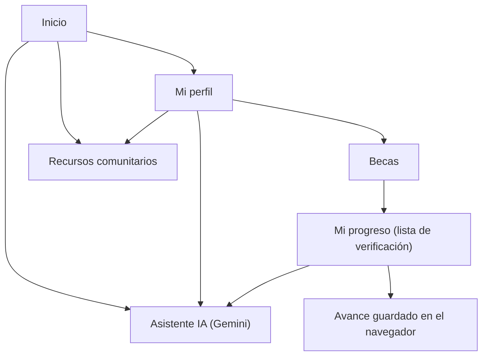
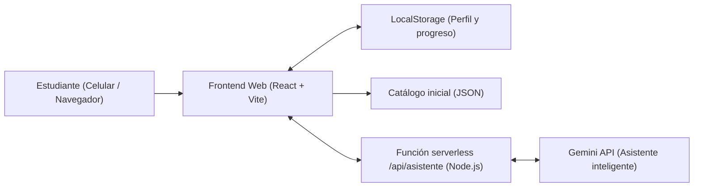

# BecaLink

**Aplicación web responsiva de acompañamiento inteligente para el acceso a becas y apoyos educativos**

| Dato | Detalle |
|---|---|
| Equipo | Bubulubu |
| Campus | San Rafael – Reforma |
| Reto | Reto 1: "Puentes de oportunidad – Reducción de la brecha de acceso" (ODS 10) |
| Integrantes | Carmona Orea Lizbeth<br>Gael Darío Squivias Moran<br>Leslie Berenice Plata Hernández |
| Repositorio | [github.com/Dsquip/Becalink](https://github.com/Dsquip/Becalink) |
| Demo en vivo | [becalink.vercel.app](https://becalink.vercel.app/) |
| Licencia | [PENDIENTE] |

## Tabla de contenido

1. [Resumen ejecutivo](#1-resumen-ejecutivo)
2. [Boceto y concepto](#2-boceto-y-concepto)
3. [Documentación funcional](#3-documentación-funcional)
4. [Documentación técnica](#4-documentación-técnica)
5. [Manual de usuario](#5-manual-de-usuario)
6. [Accesibilidad e impacto](#6-accesibilidad-e-impacto)
7. [Declaración de uso de IA](#7-declaración-de-uso-de-ia)

---

## 1. Resumen ejecutivo

BecaLink es una aplicación web responsiva para celulares que democratiza el acceso a becas, apoyos económicos y procesos de admisión educativa. Está diseñada para estudiantes de primera generación con recursos económicos o conectividad limitados que carecen de acompañamiento familiar o institucional. Su innovación consiste en integrar Gemini como asistente inteligente para eliminar la barrera del lenguaje burocrático: traduce convocatorias complejas a explicaciones claras, ayuda a organizar los documentos de cada postulación y acompaña la redacción de cartas de motivos, ayudando a que más jóvenes completen sus postulaciones en condiciones equitativas.

---

## 2. Boceto y concepto

### El problema

Las convocatorias de becas, apoyos económicos y procesos de admisión educativa suelen publicarse en lenguaje burocrático, técnico o poco claro. Esta barrera informativa provoca que miles de jóvenes con talento desistan o queden fuera de oportunidades clave por no comprender los requisitos, los plazos o el procedimiento correcto para postularse. El problema afecta con mayor fuerza a estudiantes de primera generación que no cuentan con acompañamiento familiar o institucional cercano para interpretar estos trámites.

### Propuesta de solución

BecaLink es una aplicación web responsiva diseñada prioritariamente para celulares que actúa como un puente informativo y guía práctica. Mediante inteligencia artificial (Gemini), transforma textos oficiales extensos en explicaciones comprensibles y brinda acompañamiento en la preparación de documentos clave. Además, ayuda al estudiante a llevar el control de su postulación y a encontrar recursos comunitarios cercanos, canalizando siempre a los enlaces oficiales o puntos de atención correspondientes.

### Flujo general de pantallas



**Descripción de pantallas:**

1. **Inicio (`/`):** presenta el propósito de la app y tres accesos principales: explorar becas, abrir la guía de postulación y chatear con el asistente de Gemini. El botón "Comenzar mi perfil" lleva al primer paso.
2. **Mi perfil (`/perfil`):** formulario corto con cinco datos: nivel educativo, área de estudio, entidad federativa, municipio o alcaldía, y situación socioeconómica. Se guarda en el navegador, sin crear cuenta.
3. **Becas (`/becas`):** buscador con filtros por nivel educativo, entidad y tipo de apoyo, más búsqueda por texto. Muestra tarjetas con la etiqueta "Perfil compatible" cuando el nivel de la beca coincide con el del perfil guardado. Cada tarjeta enlaza a la convocatoria oficial.
4. **Asistente IA (`/asistente`):** chat con Gemini y tres acciones rápidas: traducir una convocatoria a lenguaje claro, crear una lista de documentos y orientar la carta de motivos. Usa el perfil guardado para personalizar las respuestas.
5. **Mi progreso (`/progreso`):** lista de verificación de la beca elegida, con barra de porcentaje completado, mensaje motivador, requisitos propios que el estudiante puede agregar o eliminar y opción de reiniciar. El avance se conserva en el navegador.
6. **Recursos (`/recursos`):** directorio orientativo de recursos comunitarios (bibliotecas públicas, espacios con internet gratuito, centros comunitarios, oficinas de orientación educativa, espacios con computadoras e instituciones de apoyo estudiantil). Cada recurso abre una búsqueda en mapas usando el municipio y la entidad del perfil, e indica cuáles tienen una institución de referencia verificada.

**Bocetos visuales / wireframes:** [PENDIENTE: insertar capturas o enlace a prototipo]

### Alineación con los ODS

- **ODS 10 — Reducción de las desigualdades:** democratiza el acceso a información sobre financiamiento y movilidad educativa. Al eliminar la barrera del lenguaje técnico y la desinformación, permite que jóvenes en desventaja compitan en condiciones más equitativas por becas y apoyos escolares.
- **ODS 11 — Ciudades y comunidades sostenibles:** fortalece la inclusión social y la equidad en comunidades urbanas y periurbanas al conectar a jóvenes de zonas vulnerables con servicios educativos y recursos comunitarios locales (página de Recursos), impulsando comunidades más inclusivas y con mayor movilidad social.

---

## 3. Documentación funcional

Las capacidades principales de BecaLink se estructuran en tres funciones impulsadas por Gemini, que se usan desde la página del Asistente, y dos herramientas de apoyo que funcionan en el navegador.

### Función 1: Traducción de lenguaje burocrático a lenguaje sencillo

- **Descripción:** procesa convocatorias oficiales extensas y las convierte en explicaciones claras, empáticas y adaptadas al nivel de lectura del estudiante.
- **Qué entra:** el texto de una convocatoria que el estudiante pega en el chat (acción rápida "Traducir convocatoria a lenguaje claro").
- **Qué sale:** explicación estructurada en lenguaje sencillo: qué ofrece, quién puede participar, qué documentos piden y qué fechas menciona. Si el texto no trae fechas, no se inventan.
- **Rol de Gemini:** lee el contenido oficial, interpreta la terminología administrativa y redacta una versión accesible y comprensible.

### Función 2: Lista de documentos y ruta personalizada

- **Descripción:** ayuda al estudiante a saber qué reunir y dónde tramitarlo, y a darle seguimiento.
- **Qué entra:** el perfil guardado del estudiante y su solicitud en el chat (acción rápida "Crear lista de documentos").
- **Qué sale:** lista ordenada de documentos con indicaciones de dónde se tramita cada uno. El estudiante la lleva a la página **Mi progreso**, donde marca avances en una lista de verificación guardada en el navegador.
- **Rol de Gemini:** genera la lista a partir del perfil y aclara que la lista exacta depende de la convocatoria oficial.

### Función 3: Acompañamiento en redacción y preparación

- **Descripción:** orienta al estudiante en la preparación de su carta de motivos y lo dirige a los canales formales de entrega.
- **Qué entra:** dudas del estudiante e ideas base para su carta (acción rápida "Orientación para carta de motivos").
- **Qué sale:** guía por pasos para estructurar una carta clara, honesta y respetuosa, sin tecnicismos y sin inventar datos personales.
- **Rol de Gemini:** actúa como guía conversacional para estructurar ideas y orientar hacia los canales oficiales.

### Herramientas de apoyo (sin IA)

- **Buscador de becas:** filtra el catálogo inicial de convocatorias (archivo JSON) por nivel, entidad, tipo de apoyo y texto.
- **Mi progreso:** lista de verificación con pasos generales (leer la convocatoria, CURP, identificación, constancia de estudios, comprobante de domicilio, registro y acuse), porcentaje de avance y requisitos propios.
- **Recursos comunitarios:** directorio orientativo con enlaces a mapas según la ubicación del perfil.

---

## 4. Documentación técnica

### Arquitectura general

BecaLink implementa una arquitectura cliente-servidor ligera. El navegador del usuario ejecuta la interfaz en React y almacena perfil y progreso localmente. Todas las solicitudes de inteligencia artificial pasan por una función serverless en Node.js (`api/asistente.js`) que resguarda la clave de la Gemini API en una variable de entorno. Si la función no responde, el asistente cambia a una guía local con respuestas orientativas.



### Stack tecnológico

| Tecnología | Propósito en el proyecto |
|---|---|
| HTML5 | Estructura semántica de las pantallas de la aplicación web. |
| CSS3 | Diseño visual y adaptación responsiva para pantallas de celulares. |
| JavaScript | Lógica de funcionalidad, eventos e interacción del usuario. |
| React 19 | Desarrollo modular de los componentes de la interfaz de usuario. |
| React Router 7 | Navegación entre las páginas de la aplicación. |
| Vite 8 | Herramienta de desarrollo y empaquetado del frontend. |
| Función serverless en Node.js (`api/asistente.js`) | Servidor intermedio que recibe peticiones del frontend y se conecta de forma segura con la Gemini API sin exponer credenciales. No usa dependencias externas. |
| Gemini API (`gemini-3.5-flash-lite`) | Motor de inteligencia artificial que impulsa el asistente de becas. |
| JSON | Almacenamiento del catálogo inicial de convocatorias. |
| LocalStorage | Persistencia local en el navegador para guardar perfil y avances sin requerir cuentas. |
| Node.js v26.13.1 (LTS) y npm | Instalan dependencias y ejecutan el frontend y la función en local. En Vercel, la función usa la versión de Node.js configurada en el proyecto. |
| Vercel | Publicación del frontend y de la función serverless ([becalink.vercel.app](https://becalink.vercel.app/)). |
| GitHub | Alojamiento del código fuente, control de versiones y documentación. |
| Google AI Studio | Obtención de la clave de la API y desarrollo asistido de la aplicación. |

### Integración de Gemini en el flujo de la aplicación

1. **Captura en el cliente:** en la página del Asistente, el estudiante elige una acción rápida o escribe su duda. La interfaz toma el perfil guardado, si existe.
2. **Envío a la función:** el frontend envía `POST /api/asistente` con el mensaje, la acción y el perfil. En producción y en local usa la misma dirección del sitio, sin configuración extra.
3. **Procesamiento en Gemini API:** la función lee la clave de `GEMINI_API_KEY` (nunca expuesta en el navegador), arma las instrucciones según la acción, agrega reglas fijas (no inventar datos, remitir a fuentes oficiales, no pedir datos sensibles) y consulta a Gemini con la clave en un encabezado. Ante errores temporales (429, 500, 503, 504) hace hasta 3 intentos.
4. **Respuesta:** la función devuelve `{"respuesta": "..."}` y la interfaz la muestra en el chat. Si hay un error, devuelve un código HTTP real con `{"error": "..."}` y la interfaz usa la guía local.

### Endpoint

| Método y ruta | Uso | Cuerpo de la petición |
|---|---|---|
| `POST /api/asistente` | Chat del asistente (lo usa el frontend). | `{ "mensaje": "...", "accion": "traducir \| documentos \| carta \| consulta_general", "perfil": { "nivel", "area", "entidad", "municipio", "situacion" } \| null }` |
| `GET /api/asistente` | Comprueba que la función esté activa y que la clave esté configurada. | — |

Respuesta exitosa: `{ "respuesta": "..." }`. Códigos de error, siempre con `{ "error": "..." }`: `400` falta el mensaje o el JSON no es válido, `405` método no permitido, `413` texto demasiado largo (máximo 20 000 caracteres), `502` Gemini no pudo responder, `503` clave no configurada o Gemini saturado, `504` Gemini tardó demasiado.

### Variables de entorno

| Variable | Obligatoria | Descripción |
|---|---|---|
| `GEMINI_API_KEY` | Sí | Clave de la Gemini API, obtenida en Google AI Studio. En Vercel se configura en *Settings → Environment Variables*; en local, en un archivo `.env.local`. |
| `GEMINI_MODEL` | No | Modelo de Gemini. Por defecto `gemini-3.5-flash-lite`. |
| `VITE_API_URL` | No | Dirección de otro servidor para el frontend. Por defecto está vacía y se usa la misma dirección del sitio. |

### Estructura del repositorio

```text
Becalink/
├── api/
│   └── asistente.js            # Función serverless en Node.js (Gemini API)
├── public/                     # Archivos públicos estáticos
├── src/
│   ├── assets/                 # Imágenes y recursos
│   ├── components/             # Header, BecaCard, Ilustraciones, Icons, Footer
│   ├── data/
│   │   └── convocatorias.json  # Catálogo inicial de convocatorias
│   ├── pages/                  # Inicio, Perfil, Becas, Asistente, Progreso, Recursos
│   ├── services/
│   │   └── perfilStorage.js    # Perfil del estudiante en LocalStorage
│   ├── App.jsx                 # Rutas de la aplicación
│   ├── index.css               # Estilos
│   └── main.jsx                # Punto de entrada
├── index.html
├── package.json
├── vercel.json                 # Configuración de Vercel (rutas y duración de la función)
├── vite.config.js              # Vite + atiende /api/asistente en desarrollo local
├── .gitignore
└── README.md
```

### Instrucciones para ejecutar el proyecto en local

**Prerrequisitos:**

- Node.js v26.13.1 (última versión LTS) y npm. Descarga en [nodejs.org](https://nodejs.org/en/download).
- Una clave de la Gemini API obtenida en [Google AI Studio](https://aistudio.google.com/).

**1. Clonar el repositorio e instalar dependencias:**

```bash
git clone https://github.com/Dsquip/Becalink.git
cd Becalink
npm install
```

**2. Guardar la clave de la API.** Crea un archivo llamado `.env.local` en la raíz del proyecto (ya está excluido de Git) con este contenido:

```env
GEMINI_API_KEY=tu_clave_de_gemini_aqui
```

**3. Iniciar la aplicación:**

```bash
npm run dev
```

**4. Abrir la aplicación:** entra a `http://localhost:5173`. El mismo comando sirve la interfaz y la ruta `/api/asistente`, así que no hace falta iniciar nada más.

Para comprobar que la clave quedó bien configurada, abre `http://localhost:5173/api/asistente`: debe mostrar `"claveConfigurada": true`.

> **Importante:** nunca subas la clave de la API al repositorio. El archivo `.gitignore` excluye `.env.local`.

### Despliegue

La aplicación completa se publica en Vercel ([becalink.vercel.app](https://becalink.vercel.app/)): el frontend y la función `api/asistente.js` viven en el mismo proyecto y comparten el mismo enlace.

1. Importar el repositorio en Vercel. Vercel detecta Vite automáticamente (comando `npm run build`, carpeta de salida `dist`) y publica la carpeta `api/` como funciones.
2. Agregar la variable de entorno `GEMINI_API_KEY` en *Settings → Environment Variables* (para Production, Preview y Development).
3. Volver a desplegar (*Redeploy*) para que la función tome la clave.
4. El archivo `vercel.json` redirige las rutas internas (`/perfil`, `/becas`, etc.) a `index.html` para poder abrirlas y recargarlas directamente, y amplía el tiempo máximo de la función para permitir los reintentos.

### Limitaciones conocidas

- **Persistencia únicamente local:** al guardar perfil y avances en LocalStorage, el progreso pertenece al navegador y dispositivo desde donde se usa la app. Si el usuario cambia de celular o borra los datos del navegador, su información no se transfiere automáticamente.
- **Catálogo inicial de ejemplo:** las convocatorias precargadas son tres ejemplos ilustrativos en un archivo JSON, sin fechas ni enlaces reales, y requieren actualización manual para incorporar convocatorias vigentes.
- **Dependencia de conexión para funciones de IA:** las consultas procesadas por Gemini requieren internet y que la función esté desplegada con su clave configurada. Sin ello, el asistente ofrece respuestas orientativas de respaldo, no generadas por Gemini.
- **Lista de verificación general:** los pasos de la página Mi progreso son orientativos y generales; no se generan automáticamente a partir de cada convocatoria.
- **Recursos orientativos:** el directorio de recursos comunitarios no es una base de datos de sedes; abre búsquedas en mapas según la ubicación del perfil y solo algunos recursos tienen una institución de referencia verificada.
- **Cuotas y saturación de la API:** Gemini puede responder con errores temporales (429 o 503) en horas de mucha demanda. La función hace automáticamente hasta 3 intentos antes de informar el error. Cada mensaje está limitado a 20 000 caracteres.
- **Carácter orientativo de las respuestas:** la información simplificada y las guías generadas con IA son un apoyo; el estudiante debe confirmar siempre requisitos finales, fechas y envío directamente en los enlaces oficiales de cada institución.

---

## 5. Manual de usuario

¡Hola! Bienvenido a BecaLink. Esta herramienta está pensada para acompañarte paso a paso en la búsqueda y postulación a becas o apoyos educativos, sin palabras enredadas ni trámites confusos. Puedes usarla directamente desde tu celular.

### Paso 1: Entra a BecaLink desde tu celular

1. Abre el navegador de internet de tu celular (como Chrome o Safari).
2. Escribe o toca el enlace de la aplicación: [becalink.vercel.app](https://becalink.vercel.app/).
3. No necesitas descargar nada ni ocupar memoria de tu teléfono.

### Paso 2: Crea tu perfil

1. Toca **Comenzar mi perfil** o entra a **Mi perfil** en el menú.
2. Elige tu nivel educativo y tu área de estudio, escribe tu entidad y tu municipio o alcaldía, y elige tu situación.
3. Toca **Guardar perfil en navegador**. Tus datos se guardan en tu propio celular, sin crear cuenta.

### Paso 3: Busca becas compatibles

1. Entra a **Becas** en el menú.
2. Usa los filtros (nivel educativo, entidad, tipo de apoyo) o escribe una palabra en el buscador.
3. Las becas que coinciden con tu perfil muestran la etiqueta **Perfil compatible**.
4. Toca **Convocatoria oficial** para leer la convocatoria en la página de la institución.

### Paso 4: Entiende cualquier convocatoria en palabras claras

Si encontraste una beca pero el texto oficial es muy largo o difícil de entender:

1. Entra a **Asistente IA** en el menú.
2. Toca **Traducir convocatoria a lenguaje claro** y pega el texto de la convocatoria donde dice.
3. Presiona **Enviar**. En unos segundos verás una explicación clara: de qué trata la beca, quién puede participar y qué te piden.

### Paso 5: Organiza tus documentos y tu avance

1. En el **Asistente IA**, toca **Crear lista de documentos** para saber qué reunir y dónde tramitarlo.
2. Entra a **Mi progreso** y elige la beca que quieres preparar.
3. Conforme vayas juntando tus papeles, marca cada paso como completado. Puedes agregar otros documentos que pida tu convocatoria.
4. Tu avance se guarda en el navegador de tu celular, así que puedes cerrar la página y volver después sin empezar de cero.

### Paso 6: Prepara tu carta de motivos

1. En el **Asistente IA**, toca **Orientación para carta de motivos**.
2. Cuenta con tus propias palabras qué estudias y por qué buscas el apoyo.
3. BecaLink te ayudará a ordenar tus ideas de forma clara y respetuosa, sin palabras complicadas.
4. Cuando tengas todo listo, usa los enlaces oficiales para enviar tu solicitud directamente en la página de la institución que entrega la beca.

### Paso 7: Encuentra apoyo cerca de ti

Entra a **Recursos** para ver bibliotecas, lugares con internet gratuito, centros comunitarios y otros espacios de apoyo. Si guardaste tu municipio y tu entidad en el perfil, cada recurso abre una búsqueda en el mapa cerca de ti.

### Consejos útiles para aprovechar mejor BecaLink

- **Usa siempre el mismo navegador en tu celular:** así no perderás tu perfil ni los pasos que ya marcaste.
- **Revisa siempre el enlace oficial:** BecaLink te ayuda a entender y prepararte, pero el registro final siempre se hace en la página oficial de cada convocatoria.
- **No te apresures en tu carta:** usa la guía de la app como apoyo y revisa que todo lo que escribas refleje tu propia historia y datos reales.
- **Si el asistente tarda:** a veces Gemini está muy ocupado. Espera unos segundos e intenta de nuevo.

---

## 6. Accesibilidad e impacto

### ¿Qué hace inclusiva a BecaLink?

- **Lenguaje claro y empático:** elimina la barrera del vocabulario burocrático y adapta las explicaciones al nivel de lectura del estudiante, reduciendo el estrés y la confusión al enfrentar trámites por primera vez.
- **Diseño pensado para celulares:** al ser una aplicación web responsiva, permite el acceso desde el dispositivo más común entre jóvenes con recursos limitados, sin requerir una computadora ni instalaciones pesadas.
- **Orientación a conectividad limitada:** utiliza una interfaz ligera, un catálogo inicial en JSON y guardado local en el navegador (LocalStorage), de modo que el perfil y el progreso no se pierdan si la conexión se interrumpe. Si el servidor de IA no responde, el asistente ofrece una guía local.
- **Privacidad:** no requiere crear cuenta; los datos del estudiante se guardan solo en su dispositivo.
- **Acompañamiento para primera generación:** cubre la falta de orientación familiar o institucional cercana al transformar un proceso intimidante en una ruta concreta y verificable.
- **Apoyo a la navegación asistida:** incluye enlace para saltar al contenido, etiquetas en los campos de formularios, indicación de la página activa en el menú y avisos de estado en el chat y una barra de progreso con etiqueta descriptiva.
- **Evaluación técnica de accesibilidad** (contraste, navegación por teclado, lectores de pantalla): [PENDIENTE].

### Impacto que busca generar

BecaLink busca disminuir la tasa de abandono durante el proceso de postulación a becas y admisiones educativas. A corto plazo, ayuda a que estudiantes de primera generación comprendan convocatorias y preparen postulaciones completas a tiempo; a mediano y largo plazo, contribuye a reducir la desigualdad de oportunidades educativas (ODS 10) y fortalecer la movilidad social en comunidades vulnerables (ODS 11).

### Indicadores medibles de inclusión propuestos

| Indicador | Qué mide | Meta inicial |
|---|---|---|
| Postulaciones completadas | Número de estudiantes que concluyen su lista de verificación y llegan al envío en el enlace oficial. | [PENDIENTE] |
| Convocatorias simplificadas | Cantidad de convocatorias traducidas a lenguaje sencillo y consultadas por usuarios. | [PENDIENTE] |
| Avance en listas de verificación | Porcentaje de estudiantes que completan sus documentos antes de la fecha límite. | [PENDIENTE] |
| Mejora en comprensión | Nivel de claridad reportado por el estudiante antes y después de leer la explicación en BecaLink. | [PENDIENTE] |
| Alcance móvil en público objetivo | Porcentaje de usuarios de primera generación que acceden desde dispositivos móviles. | [PENDIENTE] |
| Uso de guía de redacción | Número de cartas de motivos preparadas con apoyo de la app. | [PENDIENTE] |

---

## 7. Declaración de uso de IA

El desarrollo de BecaLink y la elaboración de esta documentación contaron con el apoyo de Gemini y Google AI Studio, herramientas empleadas para la generación y el desarrollo asistido de la aplicación, así como para estructurar y redactar el material técnico y de usuario bajo supervisión del equipo Bubulubu. Dentro del funcionamiento de la aplicación, Gemini (a través de la Gemini API conectada de manera segura mediante una función serverless en Node.js) opera como el núcleo conversacional y de procesamiento encargado de traducir convocatorias burocráticas a lenguaje sencillo, ayudar a generar listas de documentos a partir del perfil del estudiante y guiar la redacción de cartas de motivos sin tecnicismos.
